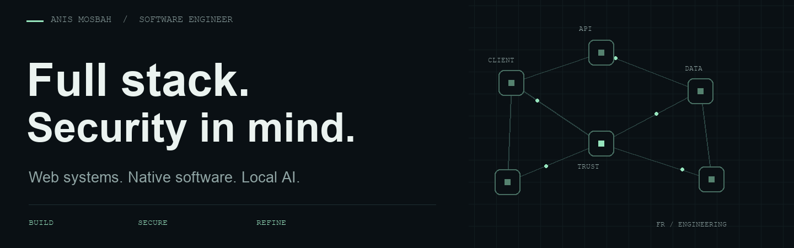

<picture>
  <source media="(prefers-reduced-motion: reduce)" srcset="banner.png">
  
</picture>

<strong>FULL-STACK ENGINEERING &nbsp; / &nbsp; APPLICATION SECURITY &nbsp; / &nbsp; LOCAL AI</strong>

France &nbsp; · &nbsp; <a href="mailto:contact@anis-mosbah.dev">Professional enquiries</a> &nbsp; · &nbsp; <a href="banner.png">Static version</a>

 

## I connect the interface to the system behind it.

I’m **Anis Mosbah**, a full-stack software engineer working across web platforms, native desktop software and AI tooling. I care about the details users feel and the boundaries they depend on: clear interactions, reliable data flows, deliberate permissions and software that is easier to maintain.

 

<table>
<tr>
<td width="50%" valign="top">

### 01 / Web & full stack

Frontend interfaces, backend services and the data between them.

`TypeScript` `JavaScript` `React` `Next.js`  
`Node.js` `REST APIs` `PostgreSQL` `MongoDB`

</td>
<td width="50%" valign="top">

### 02 / Desktop & systems

macOS integrations, cross-platform tools and release engineering.

`Rust` `Tauri` `Swift` `SwiftUI`  
`Electron` `AppKit` `Signing & updates`

</td>
</tr>
<tr>
<td width="50%" valign="top">

### 03 / AI & local workflows

Model integration, retrieval workflows and usable on-device experiences.

`Python` `LLM APIs` `RAG`  
`Local inference` `Streaming` `Embeddings`

</td>
<td width="50%" valign="top">

### 04 / Application security

Trust boundaries, API access control and practical verification.

`OAuth2` `Authorization` `API hardening`  
`Secret detection` `Dependency review` `CI/CD`

</td>
</tr>
</table>

 

## How I approach engineering

**Understand the task.** Start with the workflow and the constraints.  
**Make boundaries explicit.** Decide what data and access a feature needs.  
**Measure what matters.** Test behavior, performance and recovery paths.  
**Verify the delivery.** Check the artifact users actually run.

 

---

<strong>Have a product or engineering challenge?</strong>  <a href="mailto:contact@anis-mosbah.dev"><strong>contact@anis-mosbah.dev ↗</strong></a>

